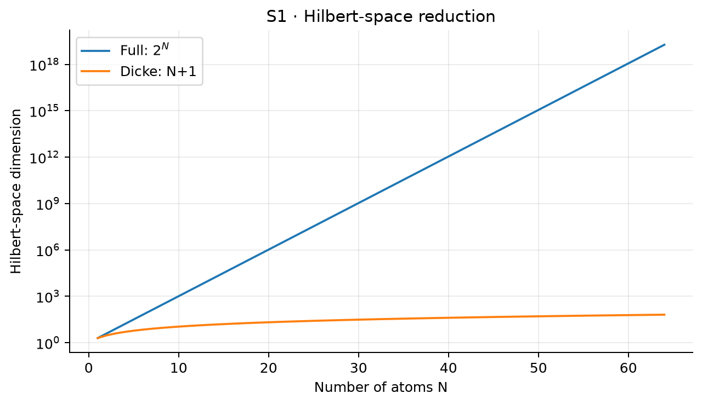
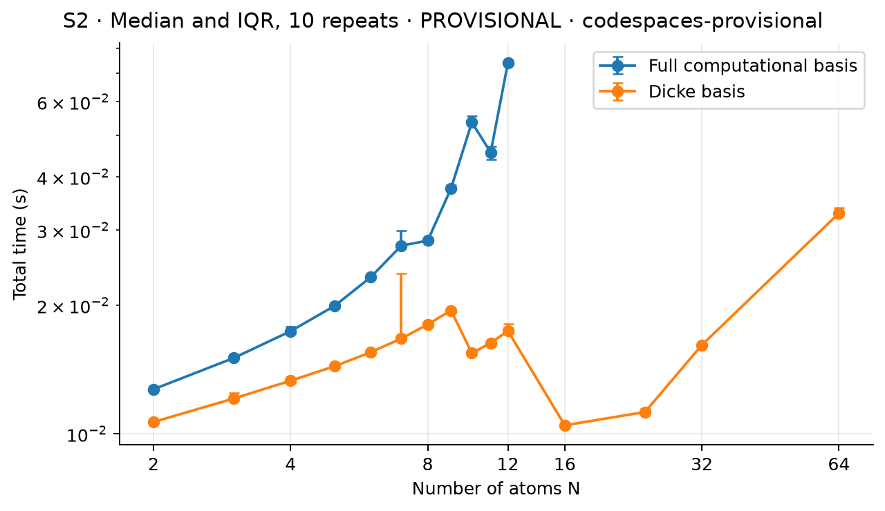
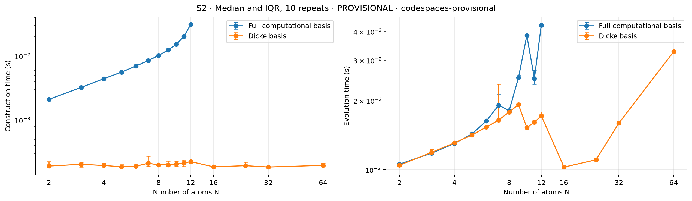
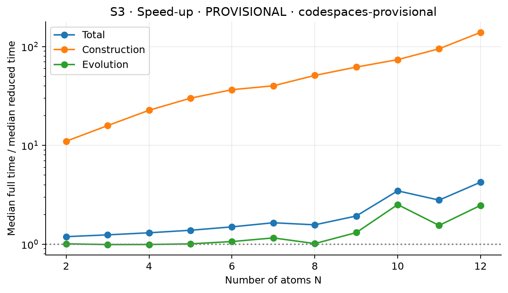
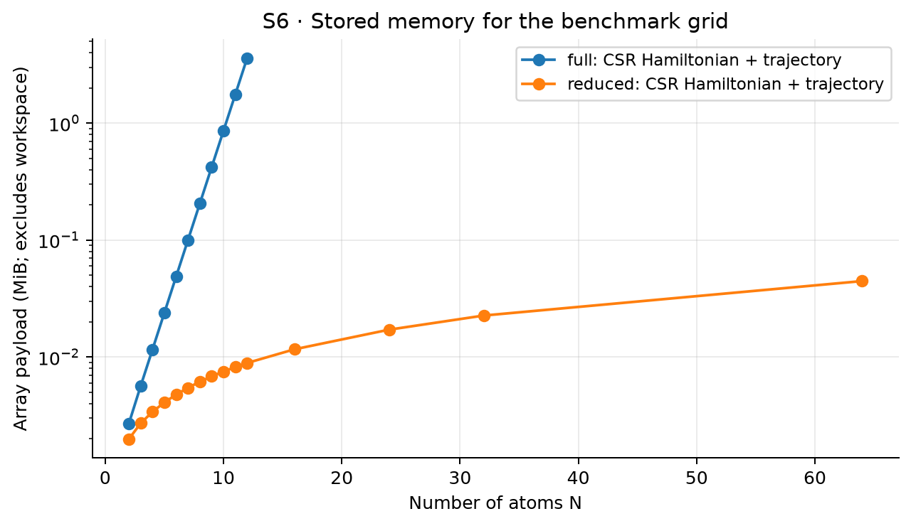
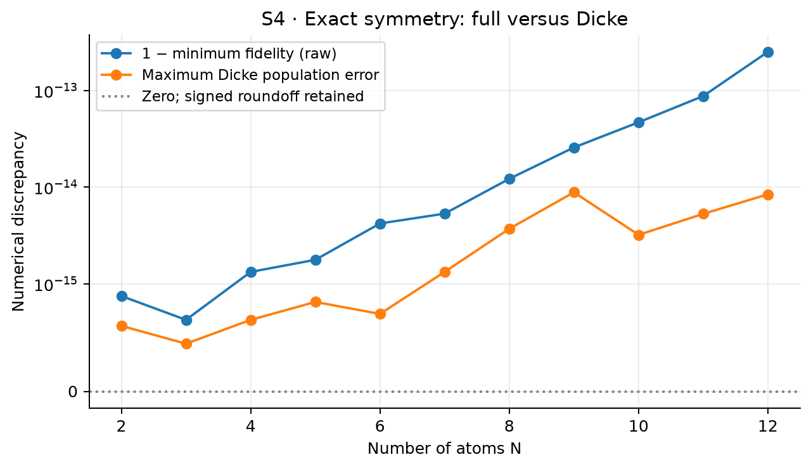
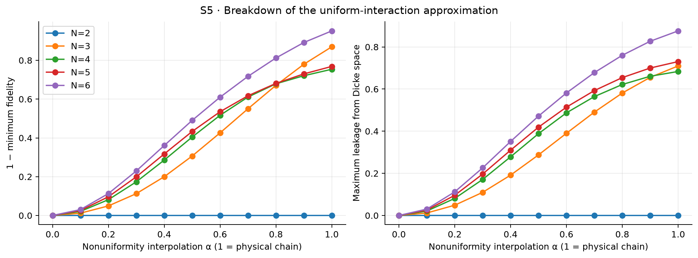

# Extension S1 — Symmetry reduction and computational scaling

## 1. Motivation

Identically driven Rydberg atoms with equal pair interactions preserve
permutation symmetry. This extension tests whether that symmetry reduces
computational cost while retaining the exact quantum dynamics. It separates
Hilbert-space dimension, measured runtime, stored memory, numerical equivalence
and the physical assumptions needed for the reduction.

The branch `extension/symmetry-scaling` starts at validated milestone tag
`milestone-v1.0`, commit `cafa485`. It lives in an isolated worktree so the
uncommitted Zeno extension and existing result changes in the original
worktree remain intact. The worktree now also includes launcher commit
`090f5dc`; `python run_project.py symmetry` runs a small untimed validation
demo for N=2–5. No milestone solver is modified.

**Benchmark status:** all timings included here are **provisional Codespaces
measurements**, not final scientific timings from the user's physical computer.
At the user's request, the final session is prepared below for local execution
and remains to be run on that computer. No
GitHub Actions timing data are used. Scientific validation is independent of
this restriction on performance claims.

## 2. Exchange symmetry for N=2

The milestone uses the ordered basis |00⟩, |0r⟩, |r0⟩, |rr⟩ and Hbar = H/ħ
in rad/s. The exchange operator swaps the middle two basis states. Identical
Ω, Δ and φ for both atoms, with the single pair interaction V, gives
[Hbar, exchange] = 0. Consequently its symmetric and antisymmetric eigenspaces
cannot couple under this Hamiltonian.

## 3. Symmetric and antisymmetric states

Define |Ψ⁺⟩ = (|0r⟩+|r0⟩)/√2 and |Ψ⁻⟩ = (|0r⟩−|r0⟩)/√2. With new basis
vectors as columns in the old basis, the unitary transformation is

\[
 B=\begin{pmatrix}
 1&0&0&0\\
 0&1/\sqrt2&1/\sqrt2&0\\
 0&1/\sqrt2&-1/\sqrt2&0\\
 0&0&0&1
 \end{pmatrix},\qquad B^\dagger B=I.
\]

Old and new coordinates satisfy ψold = Bψnew. The correct transformed
Hamiltonian is B† Hbar B, not B Hbar B† by assumption (these happen to coincide
for this real symmetric B). Tests check the explicit matrix and its unitarity.

## 4. Dark-state reduction

Writing c = Ω exp(−iφ)/√2, direct transformation of the validated Hamiltonian
gives

\[
 B^\dagger\bar H B=
 \begin{pmatrix}
 \Delta&c&0&0\\
 c^*&0&0&c\\
 0&0&0&0\\
 0&c^*&0&V-\Delta
 \end{pmatrix}.
\]

The |Ψ⁻⟩ row and column vanish: its two drive paths cancel, it has zero
single-excitation diagonal energy in this convention, and it has no double
excitation. Thus Hbar|Ψ⁻⟩ = 0 for arbitrary common detuning and phase and
either sign of V. Starting in |00⟩, PΨ−(t) = 0 to numerical precision.

This is an invariant subspace statement, not a blockade approximation. If the
initial state has an antisymmetric component, simply dropping that component
would be incorrect even though the Hamiltonian remains exchange symmetric.

## 5. 4×4 to 3×3 reduction

Deleting the unoccupied dark-state row and column gives the exact matrix

\[
 \bar H_{\rm sym}^{(2)}=
 \begin{pmatrix}\Delta&c&0\\c^*&0&c\\0&c^*&V-\Delta\end{pmatrix}
\]

on |00⟩, |Ψ⁺⟩, |rr⟩. `reduced_two_atom_hamiltonian` builds this matrix directly
using the general-N Dicke formula at N=2. Independent tests compare it with
the transformed milestone Hamiltonian and explicit matrix entries.
N=2 tests compare complex amplitudes
against the milestone pure-state solver and check the dark-state population.
The benchmark's N=2 row compares full 4-state and reduced 3-state sparse
propagation; its construction timing refers to the independent tensor and
Dicke builders, not the tiny cost of deleting a row from a prebuilt matrix.

## 6. Generalisation to Dicke states

Let nᵢ = |r⟩ᵢ⟨r| and σᵢ⁺ = |r⟩ᵢ⟨0|. The N-atom extension preserving the
milestone convention is

\[
 \bar H=\sum_i\left[\Delta(1/2-n_i)
 +\frac\Omega2(e^{i\phi}\sigma_i^++e^{-i\phi}\sigma_i^-)\right]
 +\sum_{i<j}V_{ij}n_i n_j.
\]

For two atoms the detuning contribution is Δ(1−n₁−n₂), hence the diagonal
Δ, 0, 0, −Δ. Adding Vn₁n₂ gives exactly Δ, 0, 0, V−Δ. For general N and k
excitations this derives the diagonal Δ(N/2−k), including the NΔ/2 identity
offset. Omitting that offset would change the complex-state phase relative to
the milestone even though probabilities would be unchanged.

The normalised Dicke state is the equal superposition of all bit strings with
k ones:

\[
 |D_N^{(k)}\rangle=\binom Nk^{-1/2}\sum_{|x|=k}|x\rangle.
\]

Each k-excitation configuration has N−k possible raising operations. Counting
these paths and the normalisation of adjacent sectors yields

\[
 \langle D_N^{(k+1)}|\bar H|D_N^{(k)}\rangle
 =\frac\Omega2 e^{i\phi}\sqrt{(N-k)(k+1)}.
\]

For uniform Vij = V, every k sector has exactly k(k−1)/2 excited pairs, giving

\[
 (\bar H_D)_{kk}=\Delta(N/2-k)+V k(k-1)/2.
\]

The upper off-diagonal is the conjugate of the raising matrix element. These
formulas define an independent tridiagonal model of dimension N+1. The
isometry D with Dicke columns satisfies D†D = I and, under exact symmetry,
Hbarfull D = D HbarD. This last identity checks invariance, a stronger condition
than merely checking D†Hbarfull D = HbarD.

## 7. Full-basis algorithm

[`symmetry.py`](../src/quantum_project/symmetry.py) constructs tensor embeddings
I⊗…⊗hᵢ⊗…⊗I using SciPy sparse Kronecker products. It sums all single-site
terms and all Vij nᵢnⱼ pair terms. The computational ordering is binary with
the leftmost atom as the most significant bit. All 2ᴺ amplitudes are retained;
the implementation also supports nonsymmetric initial states and nonuniform
pair matrices. It never uses excitation sectors to construct or evolve the
full model.

The Hamiltonian is stored in CSR format. At most N drive neighbours plus a
diagonal are nonzero per row, so sparse Hamiltonian storage is O(N2ᴺ), rather
than the O(4ᴺ) storage of a dense matrix. The stored trajectory remains
O(nₜ2ᴺ). Tensor construction includes N local occupations and all atom pairs;
its implementation cost is not inferred solely from the matrix dimension.

## 8. Reduced algorithm

The reduced Hamiltonian is built directly from its three diagonals, with
O(N) storage and construction work. Both methods propagate with
[`scipy.sparse.linalg.expm_multiply`](https://docs.scipy.org/doc/scipy/reference/generated/scipy.sparse.linalg.expm_multiply.html),
which computes the exponential action on the state at an equally spaced time
grid. The exact matrix trace is supplied. Neither method forms a dense unitary
or performs a time-step discretisation of the Schrödinger equation.

Using the same propagation routine avoids attributing a dense-versus-sparse
solver difference to symmetry. The independent implementations are the
Hamiltonian constructions; validation also uses the milestone eigenmethod and
an independent dense exponential for small cases. Evolution work depends on
spectral scales and requested times as well as dimension, so no universal
speed-up equal to 2ᴺ/(N+1) is assumed.

Dicke expansion into the full space is used only for validation. It is
excluded from benchmarking because including that expansion would recreate
the exponential memory cost the reduced simulation is meant to avoid.

## 9. Benchmark methodology

[`scripts/symmetry_benchmark.py`](../scripts/symmetry_benchmark.py) uses
Ω/(2π)=1 MHz, Δ/Ω=0.2, V/Ω=0.2, φ=0.37, T=0.25 μs, and 41 output times.
The same parameters and ground initial state are used for both methods at
every N. Full simulations cover N=2,…,12; reduced simulations additionally
cover N=16,24,32,64.

The session uses one untimed warm-up for every (N, method), followed by ten
repeats. N order is shuffled each round with recorded seed 20261008. At each
N, full-first and reduced-first ordering alternates, with a seeded initial
choice; each paired size has five repeats in each order. Imports, warm-ups,
metadata collection, output checking, memory accounting, plotting, CSV writing
and object disposal after timing are outside timed regions.

`perf_counter_ns` records contiguous construction and evolution intervals.
Evolution includes ground-state allocation and common input validation.
Total time is their sum. Every raw observation is retained. Summary values are
medians, quartiles and IQRs; IQR error bars describe repeat variability, not a
confidence interval for a population mean. Speed-up is the ratio of the two
method medians, not the median of paired ratios. No minimum-time selection or
outlier removal is used.

The process sets supported BLAS/OpenMP thread variables to one before numerical
imports and pins itself to one allowed logical CPU where supported. Metadata
records versions, OS, exposed CPU model/count, affinity, BLAS/LAPACK build
configuration, thread settings, seed, physical parameters, UTC start/end,
host/session identity, base Git commit, working-tree status and source hashes.
This controls the process configuration but cannot eliminate other tenants,
host scheduling, dynamic CPU frequencies, thermal effects or notebook activity.
For that reason the collected Codespaces timings remain explicitly provisional.

Before allocation, a conservative working-memory estimate must fit within
both the configured 256 MiB budget and one quarter of available memory.
Linux cgroup limits are considered. The available-memory margin is checked
again before each timed trial. Sizes beyond the full-basis budget are skipped,
while safe reduced sizes continue. No attempt is made to fill available RAM.
The defaults deliberately stop the full model at N=12 even if more RAM exists.

The script refuses scientific timing collection when `CI` or `GITHUB_ACTIONS`
is true. `--dry-run` is permitted for correctness checks and writes no timings.
It also refuses to overwrite an existing session. Plotting uses a separate
script that only reads recorded data and cannot call a benchmark. Before plotting,
it verifies session identity, physical parameters, repeat coverage, dimensions,
durations, medians, quartiles, IQRs and stored memory against the raw CSV. It
also checks that the agreement CSV matches the session-linked validation JSON.
Mixed sessions and stale summary files cause an error instead of a figure.

### Final session on the user's computer

Use a local working copy containing this branch's extension files, install the
project and test dependencies,
and close other intensive applications. Keep power mode and thermal conditions
consistent and use the same physical computer for the entire full/reduced run.
Choose a new output directory for every session. From the repository root:

```bash
python -m pip install -e '.[test]'
python -m pytest -q
python scripts/symmetry_benchmark.py --dry-run
python scripts/symmetry_benchmark.py --session-kind final --machine-label "my-computer" --output-dir results/data/symmetry_final_local
python scripts/symmetry_study.py --benchmark-dir results/data/symmetry_final_local --output-dir results/data/symmetry_final_local
python scripts/symmetry_figures.py --benchmark-dir results/data/symmetry_final_local --data-dir results/data/symmetry_final_local --output-dir results/figures/symmetry_final_local
```

The script rejects final sessions in Codespaces. Elsewhere, the physical-machine
label is the operator's assertion; the script cannot prove that a label represents
dedicated hardware. Do not combine raw timings
from different machines, sessions, physical parameter grids or thread counts.
If larger full sizes are desired, increase `--full-max` conservatively; the
memory guards remain active. The report's runtime table must then be updated
from the final session, without treating provisional timings as final data.

For the current isolated worktree and shared environment, use
`/workspaces/Quantum-Computing/.venv/bin/python` in place of `python`.
The symmetry scripts select their own worktree's `src` directory, and pytest
does so through `pyproject.toml`, even if the shared environment's editable
installation points to the original workspace. For other standalone Python
commands importing the extension, set `PYTHONPATH=src`.

## 10. Hilbert-space scaling

The full dimension is 2ᴺ; the symmetric sector has dimension N+1. At N=2 this
is 4 versus 3, at N=12 it is 4096 versus 13, and at N=64 it is approximately
1.845×10¹⁹ versus 65. S1 shows the mathematical dimensions on a logarithmic
y-axis. The N=64 full dimension is an analytical count, not a claim that the
full simulation was allocated or run.



## 11. Runtime scaling

The provisional session ran on 2026-10-08, 15:16:42–15:16:49 UTC, with Python
3.14.2, NumPy 2.5.3 and SciPy 1.18.1. The virtual machine exposed an Intel
Xeon Platinum 8573C and two logical CPUs; the process was pinned to CPU 0.
Session identifier: `a8964d8f-e174-4f1b-afab-b8cf91557cc0`.
All 260 trials were recorded after warm-up, with ten repeats per method/size.

| N | Full total median (ms) | Full IQR (ms) | Reduced total median (ms) | Reduced IQR (ms) | Total speed-up |
|---:|---:|---:|---:|---:|---:|
| 2 | 12.7242 | 0.1562 | 10.6649 | 0.1102 | 1.1931× |
| 4 | 17.4049 | 0.6113 | 13.3232 | 0.2632 | 1.3064× |
| 8 | 28.3650 | 0.3340 | 18.0453 | 0.1446 | 1.5719× |
| 12 | 73.9945 | 1.5815 | 17.4275 | 0.8792 | 4.2458× |

At N=12, construction medians are 31.2278 ms full and 0.2243 ms reduced;
evolution medians are 42.5544 ms full and 17.2048 ms reduced. The evolution-only
benefit is therefore about 2.47×, substantially smaller than the construction
benefit. At N=2, evolution alone is nearly equal (10.5902 versus 10.4785 ms).
At N=64 the reduced total median is 32.8946 ms (IQR 1.0329 ms); there is no
corresponding full-basis timing. These values are observations of this process
and configuration, not final physical-computer results.

The median of the measured sum need not equal the sum of the separate
medians, although every individual trial's total equals its two intervals.

Small-N overhead limits the benefit of reducing an already tiny matrix.
Construction and evolution are shown separately because the tensor-product
builder and the exponential action have different cost profiles. At larger
N the reduced evolution can also slow as the interaction diagonal grows like
VN², requiring more work per exponential action. The finite scan is empirical;
it does not establish a universal runtime exponent or a hardware-independent
speed-up. All timing figures are visibly marked **PROVISIONAL**.





## 12. Memory scaling

The raw and summary timing CSVs include exact CSR payload bytes (data, indices,
indptr), trajectory payload bytes, and a separate estimated working-memory
requirement. Exact payload does not include Python objects, local tensor
operators retained during construction, temporary sparse sums, exponential
workspace, allocator caches or interpreter memory. The preflight estimate
includes multiple buffers and is a safety heuristic, not measured peak RSS.

At N=12 the full Hamiltonian payload is 1,081,348 bytes and the 41-state
trajectory is 2,686,976 bytes, totalling 3,768,324 bytes (3.594 MiB).
The reduced equivalents are 796 and 8,528 bytes, totalling 9,324 bytes
(0.00889 MiB). Stored payload is therefore about **404.15× smaller**.
The conservative working estimates are 19,726,400 and 33,968 bytes; neither
is a measured peak. This safely fits the 256 MiB session budget.

At N=64 the reduced Hamiltonian and trajectory together occupy 46,764 bytes
(0.0446 MiB). No full-space array or Dicke expansion is constructed at that N.

With the shared sparse implementation, the relevant Hamiltonian comparison is
O(N2ᴺ) versus O(N), and trajectory storage is O(nₜ2ᴺ) versus O(nₜN).
A hypothetical dense full Hamiltonian would scale as 4ᴺ, but that is not the
implementation benchmarked here.



## 13. Numerical equivalence

For every paired benchmark N, the Dicke state is expanded by the normalised
isometry D and compared to the full state using

\[
 F(t)=|\langle\psi_{\rm full}(t)|D\psi_D(t)\rangle|^2,
 \qquad \mathrm{error}(N)=1-\min_t F(t).
\]

The raw overlap is retained without normalising either trajectory. Slight
roundoff above unity is visible in the NPZ; only a negative scalar infidelity
is floored at zero for reporting. S4 displays raw signed infidelity on a
symmetric logarithmic axis with a linear region within ±1e-15; negative
roundoff is retained. Absolute fidelity error, raw and phase-aligned
complex-amplitude error, and state norm drift are also reported, preventing
fidelity rounding from hiding an implementation error.

The aligned amplitude diagnostic multiplies each expanded state by
exp(−i arg(⟨ψfull|ψexpanded⟩)) before comparison, so an arbitrary global phase
does not count as a physical discrepancy. The raw amplitude diagnostic remains
available to check the shared energy-offset convention.

Observables are total excitation ⟨∑nᵢ⟩, the zero-excitation probability, and
every Dicke-projector population |⟨Dk|ψ⟩|². For nonsymmetric states, these
projector probabilities are not the same as the full probability of k
excitations; nonsymmetric states within that number sector are excluded.
The full excitation observable is calculated from all computational amplitudes.

The maximum sampled infidelity over N=2,…,12 is **2.50×10⁻¹³**. This includes
floating-point accumulation in the full-dimension inner product as well as
propagation, and is far below the physics errors in the spatial approximation.
Across the same scan, maximum raw complex-amplitude error is 7.76×10⁻¹⁵
(7.67×10⁻¹⁵ after phase alignment), excitation-number error 2.93×10⁻¹⁴,
ground-probability error 1.11×10⁻¹⁵, and Dicke-projector population error
8.85×10⁻¹⁵. The independent N=2
milestone comparison has maximum complex-amplitude error 7.79×10⁻¹⁶,
maximum excitation-number error 2.00×10⁻¹⁵, and maximum ground/Dicke-population
error 1.56×10⁻¹⁵. Its dark population is at most **1.26×10⁻³²**.
The raw N=2 infidelity is −4.44×10⁻¹⁶ from overlaps slightly above one; the
reported nonnegative value is zero, rather than an assertion of exact arithmetic.

The resumed implementation has **345 tests**: **254 milestone tests**, **34
launcher tests**, **52 symmetry tests**, and **5 independent recovery tests**.
The launcher is now part of this worktree. The Zeno implementation remains in
the separate original worktree and is not a dependency of this extension.
See the [resumption record](symmetry_resume.md) for the latest verification.

Tests cover the transformation, unitarity, dark state, N=2 matrix and dynamics,
Dicke normalisation, dimensions, pair counting, the full intertwining identity,
signed interactions and complex drive phases, independent dense exponentials,
invalid inputs, spatial symmetry breaking, raw-data summary arithmetic and
the CI/memory benchmark guards, and rejection of mixed or stale plotting data.



## 14. Breakdown for spatial Rydberg interactions

For equally spaced positions xi = ia in one dimension,

\[
 V_{ij}=C_6/[a|i-j|]^6.
\]

Nearest neighbours have Vnn = C6/a⁶, next-nearest neighbours Vnn/64, and
third-nearest neighbours Vnn/729. For N≥3, arbitrary permutations change the
pair-distance pattern. Reflection may remain a symmetry, but full permutation
symmetry generally does not. For N=2 there is only one pair, so this particular
mechanism does not break exchange symmetry.

The small-N study uses N=2,…,6, a=1 μm, C6=2Ω μm⁶ in angular-frequency units,
Ω/(2π)=1 MHz, Δ=φ=0, T=0.5 μs and 101 times. This C6 is a model parameter,
not an asserted value for a particular atomic species or Rydberg level.
The uniform approximation uses the arithmetic mean over all unordered pairs.

To vary nonuniformity without changing the mean interaction, define
Vij(α) = (1−α)Vmean + αVij,chain, α=0,…,1 in increments of 0.1.
Only α=1 is the physical inverse-sixth-power chain; intermediate values are
a controlled mathematical interpolation. The CSV records both α and the
coefficient of variation std(Vij)/|Vmean|.

The mean-pair Dicke model is exactly the projected matrix D†Hbarfull D, since
every pair has occupation probability k(k−1)/[N(N−1)] in a Dicke state.
Nevertheless it is **not** an exact dynamical reduction: the full Hamiltonian
couples symmetric states out of that subspace. The study measures the
Frobenius norm of Hbarfull D − D HbarD, full-versus-approximate fidelity, all
observable errors, and the population lost from the symmetric subspace.

At α=1 (the physical chain), the results are:

| N | 1 − minimum fidelity to mean-pair Dicke model | Maximum population outside symmetric subspace |
|---:|---:|---:|
| 2 | 2.89×10⁻¹⁵ | 4.44×10⁻¹⁶ |
| 3 | 0.869627 | 0.709792 |
| 4 | 0.753876 | 0.683554 |
| 5 | 0.768489 | 0.730445 |
| 6 | 0.951563 | 0.876057 |

The mean-pair approximation is poor for this chosen chain and evolution
window. This is genuine leakage and phase/dynamical error, not a numerical
failure of the exact symmetric implementation. At α=0 the uniform model
agrees to roundoff; S5 and the raw CSV show the intermediate α dependence.
Errors need not grow monotonically with atom number or with nonuniformity
for arbitrary observation windows, because the dynamics remain coherent.

Unequal drives, unequal detunings, differing laser phases or a nonsymmetric
initial state can also invalidate the N+1 model. Symmetric Hamiltonians preserve
other permutation sectors too; a generic state or permutation-invariant mixed
state need not be supported solely in the fully symmetric Dicke sector.
Changing the symmetry or enlarging the reduced state space would then require
a different model, not reuse of this N+1 assumption without validation.



## 15. Conclusions

The exact symmetric model reduces state dimension from 2ᴺ to N+1 while
preserving complex dynamics, fidelity and observables under its assumptions.
N=2 is an exact dark-state reduction of the validated milestone, including its
detuning offset and phase convention. Sparse full-basis calculations provide
the reference; measured performance must be distinguished from dimension ratios.

Spatially varying interactions demonstrate the difference between an invariant
subspace and a merely projected Hamiltonian. A uniform mean-interaction Dicke
model is an approximation for a chain and must be assessed through errors and
leakage. The final physical-machine benchmark remains to be run by the user;
all runtime data currently in this report are provisional.

Generated files:

| Location | Contents |
|---|---|
| `results/data/symmetry_provisional/symmetry_benchmark_raw.csv` | Every provisional trial and exact array payloads |
| `results/data/symmetry_provisional/symmetry_benchmark_summary.csv` | Medians, quartiles, IQRs and memory estimates |
| `results/data/symmetry_provisional/symmetry_benchmark_metadata.json` | Session, software, CPU, BLAS/LAPACK, limits and source hashes |
| `results/data/symmetry_agreement.csv`, `.npz` | Exact comparison metrics and complex trajectories for all paired N |
| `results/data/symmetry_broken.csv`, `.npz` | Nonuniformity scan, approximation errors and trajectories |
| `results/data/symmetry_validation.json` | Parameters, N=2 milestone checks and numerical summaries |
| `results/figures/S1_*` through `S6_*` | Seven figures, each as PNG and PDF; S2 also has a component figure |
